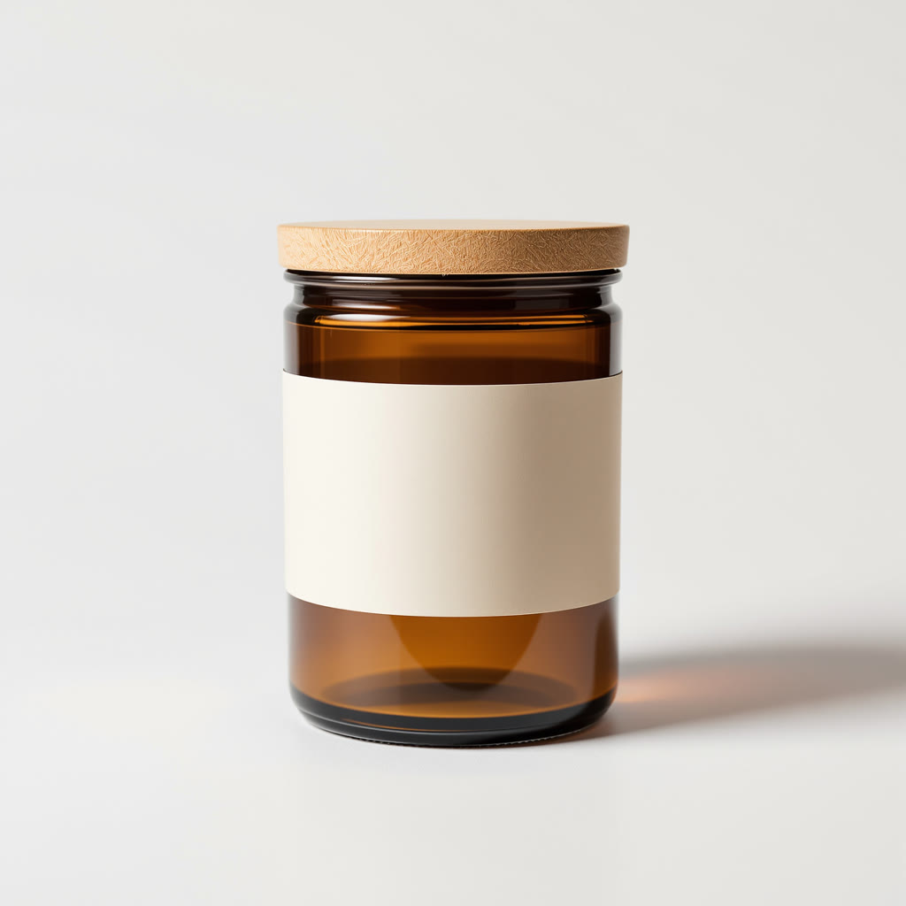
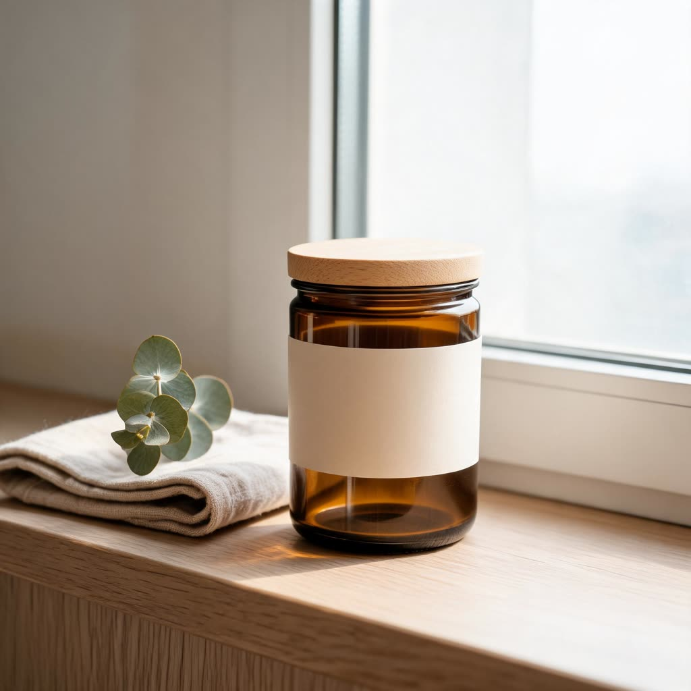
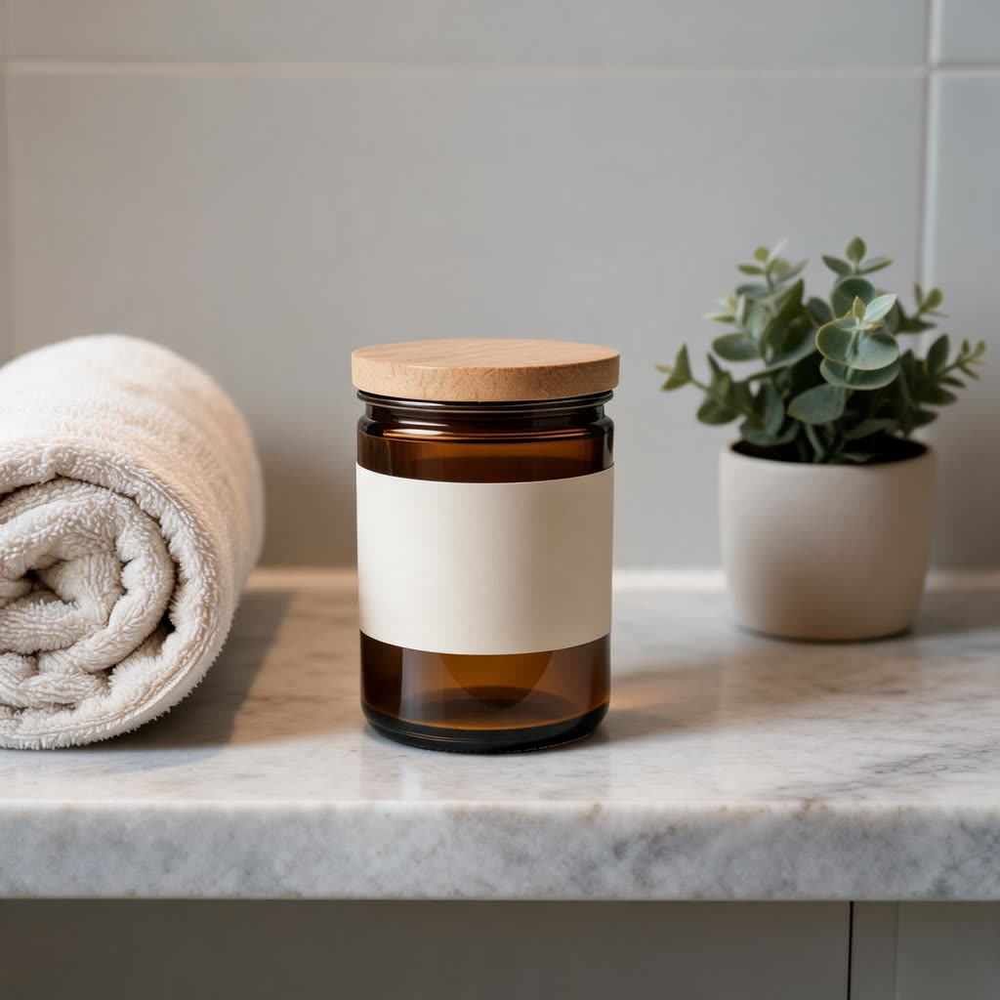

# How do I batch-generate on-brand product photos for my online store?

Write your brand look once (palette, light, props), list one row per product and scene in a CSV, then run the same image workflow once per row. This repo does that with Wireflow and Seedream 5 Lite: the product stays as photographed, every image shares the brand look, and each square photo cost 10 credits in our test.

Wireflow is our product: this repo is made by the Wireflow team, so read [Other ways to do this](#other-ways-to-do-this) with that in mind. Every other option links to its own vendor page.

| Product photo in | Row 1: windowsill | Row 2: bath shelf |
|---|---|---|
|  |  |  |

One batch run on 3 Nov 2026 from [`examples/products.csv`](examples/products.csv): 2 rows, 20 credits, runs `601b0609-d109-4b6c-b386-cfac1e8793d3` and `de00d671-e0c4-4fbe-b6e7-e14dde3ef63d`. The jar, the cork lid and the blank label match the input; the brand look's sage accent came out as the plants. The input photo was itself made with AI, so the repo holds nobody's real product.

## How the workflow works

[`workflows/on-brand-product-photo.json`](workflows/on-brand-product-photo.json) joins three texts into one prompt for Seedream 5 Lite, with your product photo as the image it edits:

1. **Product rules** (fixed): keep the product exactly as photographed, same shape, colors, label, logo and text; no added branding, badges or text.
2. **Brand Look**: the same for every row in a batch, for example "cream and oak tones with one sage green accent, soft daylight, minimal props".
3. **Scene**: one per row, for example "on a pale oak windowsill in soft morning light".

The output is a square image (`square_hd`; our test files came back at 1920x1920). Swap the model on the canvas, for example to Nano Banana Lite, and the scripts stay the same.

## Set it up

1. **Key.** In Wireflow, open **Settings > API Keys** and create a key with `workflows:write` (create the workflow and upload photos), `workflows:execute` and `executions:read` (run and read results), or **Full access** ([Authentication](https://www.wireflow.ai/docs/api/authentication), updated 20 Oct 2026).
2. **Node 18 or newer.** No packages.
3. **Save the workflow in your account** (free, runs nothing):

```bash
export WIREFLOW_API_KEY="your key"          # PowerShell: $env:WIREFLOW_API_KEY = "your key"
node scripts/create-workflow.mjs workflows/on-brand-product-photo.json
```

### Or work from your AI agent

The same account works over MCP with no key: `https://www.wireflow.ai/api/mcp`, OAuth sign-in. Steps copied from the Wireflow docs, read on 3 Nov 2026:

1. **Claude app:** **Customize > Connectors**, **+ Add**, **Add custom connector**, name `Wireflow`, paste the URL, **Continue** twice, **Add**, sign in ([Claude app setup](https://www.wireflow.ai/docs/agents/claude-app), updated 26 Oct 2026).
2. **Claude Code:** `claude mcp add --transport http wireflow https://www.wireflow.ai/api/mcp`, then `/mcp` to sign in, or open this repo, which has a [`.mcp.json`](.mcp.json) ([Claude Code setup](https://www.wireflow.ai/docs/generate-videos-in-claude-code), updated 29 Oct 2026).
3. **Cursor:** this repo's [`.cursor/mcp.json`](.cursor/mcp.json) or the same entry in `~/.cursor/mcp.json`, toggle it on under **Customize**, sign in ([Cursor setup](https://www.wireflow.ai/docs/generate-images-and-videos-in-cursor), updated 24 Oct 2026).
4. **Codex:** `codex mcp add wireflow --url https://www.wireflow.ai/api/mcp`, then `codex mcp login wireflow`, or this repo's [`.codex/config.toml`](.codex/config.toml) ([Codex setup](https://www.wireflow.ai/docs/generate-images-and-videos-with-codex), updated 24 Oct 2026).

## Run it

### 1. Write the CSV

The header names the workflow's inputs (`node scripts/wireflow-run.mjs --workflow <id> --describe` lists them), plus an `id` column that names each row. A value that starts with `@` is a local file, uploaded once and sent as its CDN URL:

```csv
id,product-photo,scene
candle-windowsill,@examples/input-candle-packshot.jpg,"On a pale oak windowsill in soft morning light, a folded linen napkin and a small sprig of dried eucalyptus beside it"
candle-bath-shelf,@examples/input-candle-packshot.jpg,"On a smooth stone bathroom shelf beside a rolled cream towel and a small potted plant, calm evening light"
```

Images that are already online can go in as `https://` URLs instead.

### 2. Check it, then run it

```bash
BRAND="brand-look=Warm, calm and natural: cream and oak tones with one sage green accent, soft daylight, gentle shadows, minimal props, plenty of space around the product."

node scripts/batch-from-csv.mjs --workflow <your workflow id> --csv examples/products.csv --input "$BRAND" --dry-run
node scripts/batch-from-csv.mjs --workflow <your workflow id> --csv examples/products.csv --input "$BRAND"
```

The dry run checks every column against the workflow's real inputs and spends nothing. The real run starts two rows at a time (`--concurrency`), waits for each, saves `./wireflow-outputs/<date>/products/<row id>/` and writes `results.csv` with each row's status, run id and files.

### 3. Rerun safely

Each row's `Idempotency-Key` is built from the CSV name, the row id and a fingerprint of the workflow and the row's inputs. Run the same file again after a crash or a timeout and rows that already started are replayed, not billed twice; change a row and it runs as new. We checked this on 3 Nov 2026: the rerun of the batch above returned the same two run ids and charged 0 credits. `--fresh` starts every row as a new run. A `429` answer is retried after `Retry-After`.

### From Claude Code instead

Ready-made skills in [`wireflowINC/skills`](https://github.com/wireflowINC/skills) quote the batch before they spend:

- [product-photography](https://github.com/wireflowINC/skills/tree/main/skills/product-photography): one product photo to white background, lifestyle, in-hand, flat lay and more (Nano Banana Lite).
- [bulk-image-generation](https://github.com/wireflowINC/skills/tree/main/skills/bulk-image-generation): a CSV or list to a folder of images plus a manifest, one quote and one yes for the whole batch (Flux Pro Ultra).
- [amazon-product-images](https://github.com/wireflowINC/skills/tree/main/skills/amazon-product-images): one product photo to a listing gallery of 2K squares (Seedream 5 Lite).
- [ai-workflow-runner](https://github.com/wireflowINC/skills/tree/main/skills/ai-workflow-runner): runs your own workflow, such as this repo's, once per CSV row after an estimate and your yes.

Install one with `npx skills add wireflowINC/skills --skill product-photography`. Or paste the list prompt from [prompts you can paste into Claude](https://www.wireflow.ai/docs/agents/claude-prompts): Claude Code writes the same one-run-per-line script, runs the first two lines and waits for your yes before the rest.

## What it costs

From the [model list](https://www.wireflow.ai/api/v1/models) (read 3 Nov 2026): Seedream 5 Lite 10 credits an image, Nano Banana Lite 16, Flux Pro Ultra v1.1 19. Our two rows were charged 10 each. Each row is its own run: the API docs describe one run per request, with no bulk endpoint and no batch discount ([run a workflow from your app](https://www.wireflow.ai/docs/trigger-a-workflow-from-your-app), updated 1 Nov 2026). API access is on every Wireflow plan and runs use credits ([pricing](https://www.wireflow.ai/pricing)). For one reusable layout with many outputs, see [batch image generation with the Compositor](https://www.wireflow.ai/docs/batch-image-generation), and for more shot types, Wireflow's [AI product photography page](https://www.wireflow.ai/ai-product-photography).

## What's in this repo

| File | What it is |
|---|---|
| [`workflows/on-brand-product-photo.json`](workflows/on-brand-product-photo.json) | The tested workflow: product rules + brand look + scene into Seedream 5 Lite |
| [`scripts/batch-from-csv.mjs`](scripts/batch-from-csv.mjs) | One run per CSV row, safe reruns, `results.csv` |
| [`scripts/wireflow-run.mjs`](scripts/wireflow-run.mjs) | One run: uploads `@local` photos, waits, downloads, writes `manifest.json` |
| [`scripts/create-workflow.mjs`](scripts/create-workflow.mjs) | Lints the workflow file, saves it in your account, prints its id |
| [`examples/products.csv`](examples/products.csv) | The two tested rows |
| [`examples/input-candle-packshot.jpg`](examples/input-candle-packshot.jpg) | The AI-made sample product photo |
| [`.mcp.json`](.mcp.json), [`.cursor/mcp.json`](.cursor/mcp.json), [`.codex/config.toml`](.codex/config.toml) | MCP configs for Claude Code, Cursor and Codex |

## Other ways to do this

Facts below are from each vendor's own pages, as recorded in our tool fact files on the dates shown.

- **[Photoroom](https://www.photoroom.com/batch)**: Batch Processing applies the same background, framing, cleanup or lighting across many product photos at once, and the Photoroom MCP connects it to Claude; Pro is $7.50 a month billed yearly with 8,000 AI credits and 1,000 exports (Photoroom batch and pricing pages, checked 11 Oct 2026).
- **[Pebblely](https://pebblely.com/)**: places your product in generated backgrounds, with bulk generate on Basic (US$19 a month, 200 images) and Pro (US$39, 500 images) (Pebblely pricing, checked 11 Oct 2026).
- **[Claid](https://claid.ai/)**: an image editing API for product photos with a batch endpoint (`POST /v1/image/edit/batch`) over a cloud storage folder or a list of URLs; the API key comes with the Pro plan (Claid docs and pricing, checked 11 Oct 2026).
- **[Pixelcut](https://www.pixelcut.ai/)**: background removal, upscaling and AI backgrounds, with 1,000 batch exports a month on Pro ($10 a month, or $8 billed yearly) and an MCP server (Pixelcut pricing and docs, checked 11 Oct 2026).
- **[Bria](https://bria.ai/)**: image generation and editing from models trained on licensed data, by API, MCP or SDK; pay as you go from $0.018 a generation, with 100 free generations (Bria pricing, checked 11 Oct 2026).
- **[Flair](https://flair.ai/)**: a product photo generator with a Bulk Content Generation feature; Pro is $8 a month, and API access is listed for Enterprise (Flair pricing, checked 11 Oct 2026).

## Tested

| | |
|---|---|
| Date | 3 Nov 2026 (2026-11-02 22:49 UTC) |
| Host | Wireflow REST API, called by `scripts/batch-from-csv.mjs` on Node 24, Windows 11: one upload through `POST /api/v1/media/upload`, then one `POST /api/v1/workflows/{id}/run` per row |
| Model | Seedream 5 Lite (edit), two 1920x1920 JPEGs |
| Run ids | `601b0609-d109-4b6c-b386-cfac1e8793d3` (windowsill), `de00d671-e0c4-4fbe-b6e7-e14dde3ef63d` (bath shelf); the rerun replayed both |
| Credits | 20 (10 + 10), then 0 for the rerun, from the account's credit history |

The MCP setup steps are copied from the Wireflow docs on 3 Nov 2026; the test did not sign in over MCP. We re-check the docs, the model list and this block once a month.

## License

[MIT](LICENSE). The example photos were made with AI on Wireflow.
